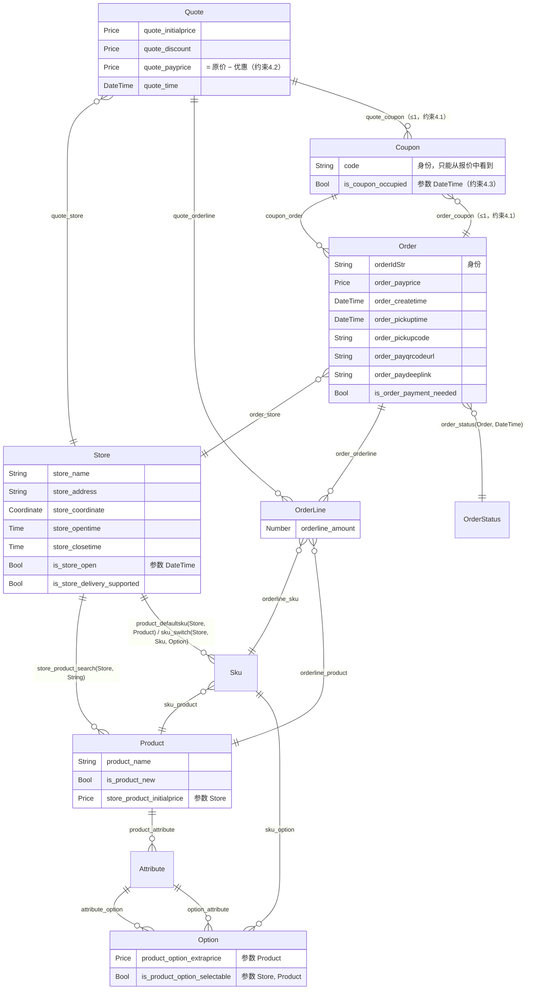
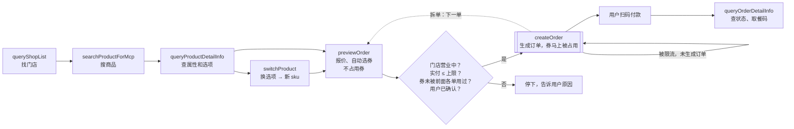

# 瑞幸点单 CO 关系图

这是 [luckin-co.md](luckin-co.md) 的可视化版本，概念和算子以那份文档为准。图里的每条边都对应一个返回概念的算子（Operator），边上的标签就是算子名称。算子分属性、谓词、关系、变换等几类（见 `luckin-co.md` 第 3 节），图里只画返回概念的那几类，即二元关系，以及多元关系和变换（按第一个输入画）。

- 框：概念（Concept）。
- 线：一个返回概念的算子，从输入概念指向返回概念。`||` 表示单值，`o{` 表示多值（集合）。
- 属性（返回值）和谓词（返回 Bool）列在框里。

## 下单流程中的工具

下面是点单时调用工具的顺序。工具不是 CO 里的 Operator，每个工具实现了哪些算子见 `luckin-co.md` 第 7 节。普通框是读工具，双线框是写工具，菱形是前置条件检查。

## 维护

改了 `luckin-co.md` 里的算子声明后，要同步改这张图。图里每条边的标签是算子名称，搜一下名称就能对上。
